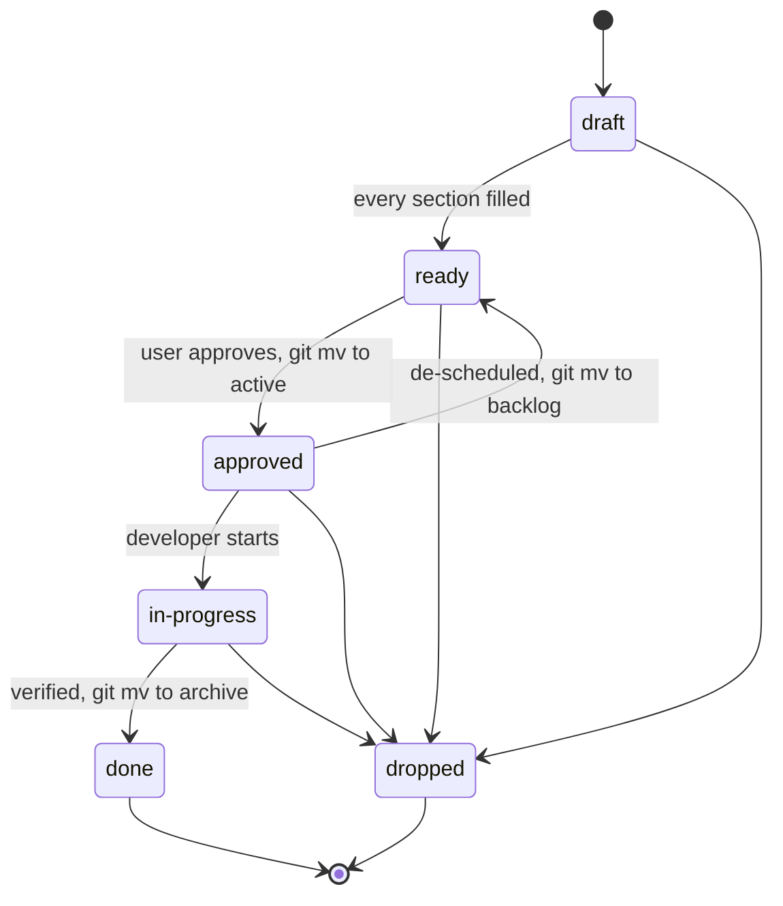

# Specs

Non-trivial work starts from a written spec. The spec is the contract: code is
written against it, tests are derived from it, verification checks it. It ships
in the same change as the code.

## Layout

| Path | Holds |
|---|---|
| `_templates/` | Feature, refactor and issue templates |
| `features/backlog/<slug>/` | Specs drafted or ready, not started |
| `features/active/<slug>/` | Approved or in progress |
| `features/archive/<slug>/` | Done or dropped — a historical snapshot, not rewritten |
| `issues/<slug>.md` | Open issues found outside any active spec, one per file |

A spec folder holds `spec.md`, and optionally `plan.md` (the *how*, as
checkable items) and `issues.md` (discoveries). They
move together.

`<slug>` is plain kebab-case naming the behaviour (`sleep-timer`), never the
ticket key — that lives in the frontmatter, so the folder survives re-ticketing.

## When a spec is required

The single source for this threshold; other files link here.

**Required** when the work does any of:
- changes more than 3 files
- adds a screen, endpoint, command or other user-facing entry point
- changes a module's public API, or moves types across modules
- changes a layer boundary, the DI/wiring structure, or adds a top-level folder
- changes a wire protocol, schema or persisted data shape

**Not required:** bug fixes (`/bugfix`), copy and string changes, dependency
bumps, single-file adjustments, single-module internal cleanup.

When genuinely unclear, write the spec.

## Lifecycle



| Step | Owner | Result |
|---|---|---|
| Write and complete | `ba` | `backlog/<slug>/spec.md`, `draft` → `ready` |
| Approve and pick up | user approves; orchestrator moves | `active/<slug>/`, `approved` |
| Implement | `developer` | code; `in-progress` |
| Tests from criteria | `tester` | tests, green suite |
| Verify per criterion | `qa` | pass / fail / blocked per criterion |
| Archive | `qa` (or `ba` if the project has no `qa`) | `archive/<slug>/`, `done` |
| Drop, on the user's decision | `ba` | `archive/<slug>/`, `dropped` with `dropped: <reason>` |

`developer` works only from `active/` at `approved` or later.

## Archive

Archive (or drop) in this order:

1. **Migrate open issues.** Each unticked `issues.md` item becomes
   `specs/issues/<slug>.md` from the issue template, with
   `origin: <feature slug>`. Rewrite the line as
   `- [→] [specs/issues/<slug>.md](<relative link>)`. If a matching issue file
   exists, add the missing details to it instead.
2. **Fix inbound links.** Grep the slug under `specs/`, `docs/` and `.claude/`
   and repoint `active/` or `backlog/` paths to `archive/`.
3. **Move and close.** `git mv` the folder to `archive/<slug>/` and set
   `status: done` (or `dropped` with `dropped: <reason>`).

Never archive as `done` with a failing or unverified criterion.

## Issues

Discoveries during spec work go in `issues.md` beside the spec, never into the
spec, one per line:

```text
- [ ] **<type>/<severity>** <one-line description> — <path:line>
```

| Marker | Meaning |
|---|---|
| `[ ]` | Open |
| `[x]` | Fixed within this feature |
| `[→]` | Migrated to `specs/issues/` at archive |
| `[-] won't-fix: <decision>` | Contradicts a decision the user made; not migrated |

`type`: `bug | gap | tech-debt | follow-up`. `severity`: `high | medium | low`.

`specs/issues/<slug>.md` holds one open item per file, from the issue template.
It has no status: the file existing means the issue is open; deleting it closes
it — in the fix change, or on promotion to a spec carrying
`origin: issue/<slug>`. Slugs are `<area>-<symptom>`, 2–5 words. Before creating
one, check for an existing file covering the same issue and extend it instead.

| `route` | Consumed by |
|---|---|
| `bugfix` | `/bugfix` |
| `feature` | `/feature`, which promotes it to a spec |
| `refactor` | `/refactor` |

Triage only on request: `ba` reports duplicates, stale items and promotion
candidates, and changes nothing without approval.

## Rules

- **Fill every section**, or write `n/a` and why.
- **Acceptance criteria are numbered and objectively pass/fail.**
- **A wrong spec stops work.** The finder reports it; only `ba` revises the
  spec, and the user re-approves a changed scope.
