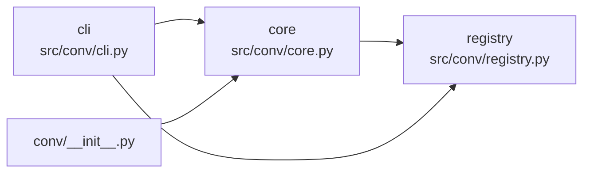

# Architecture — test-converter

## Context

`conv` converts values between units, as a command-line tool (`conv 100 C F`
prints `212.0`) and as an importable Python library (`conv.convert`). Units
are data in registries grouped by quantity: the default registry holds
temperature (C, F, K); a separate distance registry holds mm, cm, m, km, in,
ft, yd and mi, selected on the command line with `-d` / `--distance`.
`conv --units` lists the units of both registries, grouped by quantity.

It talks to nobody: no network, no files, no services. Its only users are a
person at a terminal (through the console script `conv`) and other Python code
(through the package `conv`).

## Modules

| Module | Path | Purpose |
|---|---|---|
| `conv` | `src/conv/` | The library and its CLI, in three layers: `registry` (units as data), `core` (conversion), `cli` (argument parsing and output) |

One installable package. Its layers are files inside it:

| Layer | File | Holds |
|---|---|---|
| `cli` | `src/conv/cli.py` | `main(argv, registry, *, distance_registry) -> int`, the console-script entry point: parses arguments, picks the registry, formats results, lists (`--list`, `--units`), turns `ConversionError` into `conv: error: …` and exit 1 |
| `core` | `src/conv/core.py` | `convert(value, from_unit, to_unit, registry=None) -> float` and `ConversionError`: lookup, same-quantity check, affine conversion through the base unit, minimum check, overflow check |
| `registry` | `src/conv/registry.py` | `Unit`, `Quantity`, `Registry`; `build_default_registry()`, `build_distance_registry()`; the module-level `DEFAULT_REGISTRY` and `DISTANCE_REGISTRY` |
| package facade | `src/conv/__init__.py` | Re-exports `convert` and `ConversionError` from `core` |

## Layers and dependency direction

Dependencies point one way: **`cli` → `core` → `registry`**.

- `registry` imports nothing from the package; it is plain data and lookup.
- `core` imports only `registry`.
- `cli` imports `core` and `registry`: it needs the registry types and the
  built-in registries to pick one (`-d`) and to list units (`--list`,
  `--units`). Using a lower layer directly is allowed; importing a higher one
  is not.
- The package facade imports only `core`; no layer imports the facade.

## Boundaries and interfaces

| Boundary | What crosses it |
|---|---|
| user → `cli` | Process arguments `<value> <from> <to>`, `--list`, `--units`, `--help`, optionally `-d` / `--distance` anywhere; out: one result line on stdout, or `conv: error: …` on stderr; exit 0 or 1 |
| `cli` → `core` | A call `convert(float, str, str, registry=Registry)`; back: a float, or `ConversionError` |
| `cli` → `registry` | Reads `DEFAULT_REGISTRY`, `DISTANCE_REGISTRY` and `Registry.quantities()` to choose a registry and to print lists; never converts |
| `core` → `registry` | `Registry.find(spelling)` for lookup; reads `Quantity` and `Unit` fields (factor, offset, `min_base`, `min_tolerance`, `below_min_message`) |
| Python caller → package | `conv.convert`, `conv.ConversionError`, `conv.registry.build_default_registry()`, `conv.registry.build_distance_registry()`, `conv.cli.main` (fixed public names) |

- All conversion logic lives in `core`; the CLI holds none and calls
  `conv.cli.convert` (the name it imports from `core`), so tests can patch it.
- Registries are built at import time and only read afterwards; there is no
  shared mutable state at run time.
- `main` takes a test registry (`registry=`) and a test distance registry
  (`distance_registry=`) so tests can pass fresh in-memory registries.
- `--units` merges the quantities of the registry `main` was given (default:
  `DEFAULT_REGISTRY`) and the distance registry, sorted by quantity name, units
  in registration order; it lives in `cli` and adds no module.

## External dependencies

| Dependency | Kind | Used for |
|---|---|---|
| Python 3.12 standard library (`math`, `sys`, `dataclasses`) | runtime | Everything; `dependencies = []` in `pyproject.toml` |
| `uv` / `uv_build` | build | Environment, lock file, package build |
| `pytest` | dev | Unit (`tests/unit`) and acceptance (`tests/acceptance`) tests |
| `ruff` | dev | Lint and format |

No external services or APIs; no test doubles beyond fresh in-memory
registries.

## Why

| Decision | Why |
|---|---|
| One package `conv` with three layers as files, not three packages | The product is a few hundred lines; the spec fixes the public names `conv.convert`, `conv.ConversionError`, `conv.cli.main` and `conv.registry.build_distance_registry`, which all sit in one package |
| Direction `cli` → `core` → `registry` | Units are data and must not know how they are converted or printed; the CLI must hold no conversion logic (AC-3.10, AC-7.9) |
| `cli` may import `registry` directly | It needs the built-in registries and their quantities to pick a registry for `-d` and to print `--list` / `--units`; routing that through `core` would add pass-through code with no logic |
| Distance in its own registry, not in the default one | Adding it to the default registry would change AC-2.1 (registry holds exactly temperature) and AC-4.1 (exact `--list` output) |
| `--units` as a flag in `cli`, merging both registries there | The spec places it in `conv/cli.py` with no new module or dependency; listing is output, which is the CLI's concern |
| Per-quantity minimum, tolerance and message as `Quantity` data | Temperature (0 K, 1e-9 K tolerance, "absolute zero") and distance (0 m, no tolerance, "negative") share one check in `core` without branching on the quantity |
| Standard library only, `src/` layout, `uv_build` | Fixed by the stack: no runtime dependencies; build backend was the developer's choice and is what `pyproject.toml` has |
